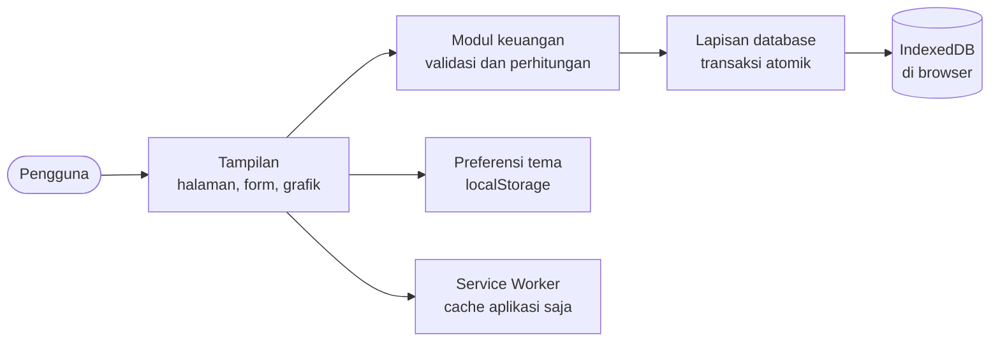
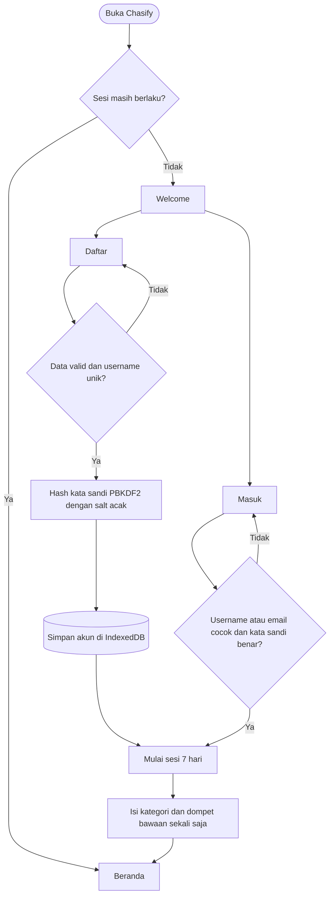
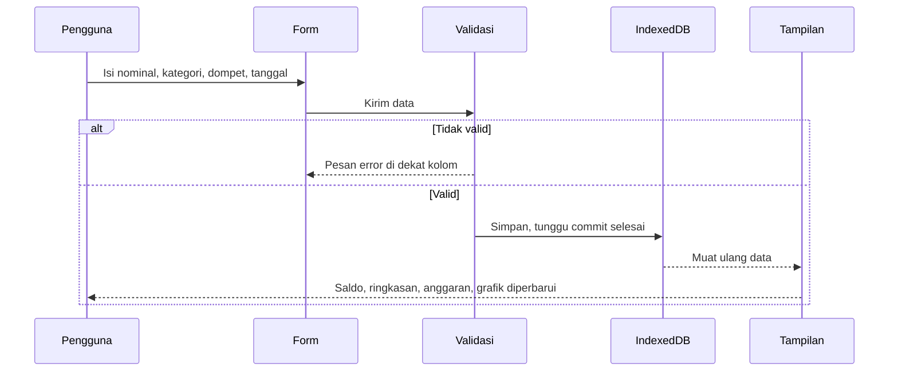
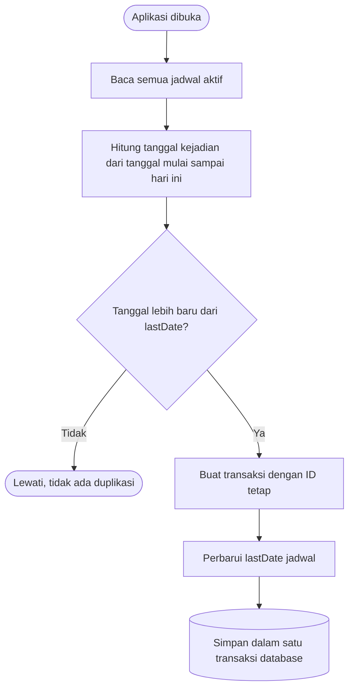
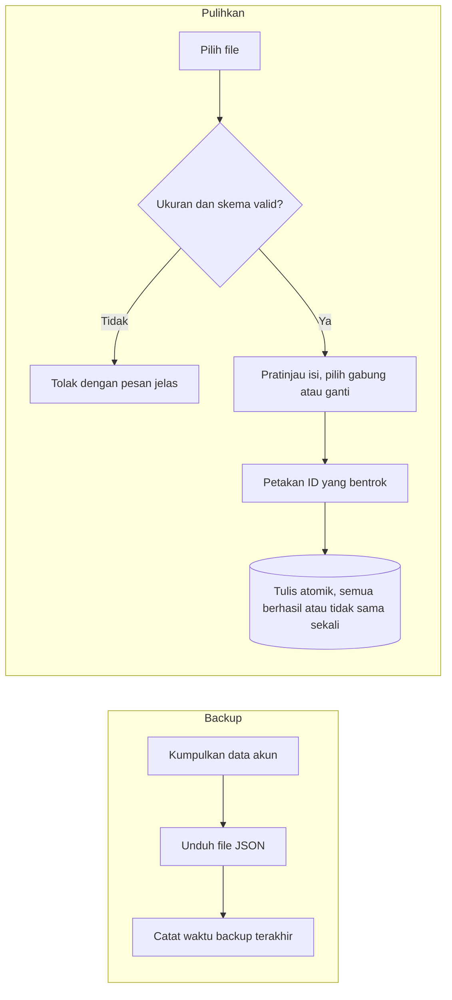

<p align="center"></p>

<p align="center">


</p>

<h3 align="center">Kelola uang dengan jelas, langsung di browser Anda.</h3>

<p align="center">Aplikasi pengelolaan keuangan pribadi yang modern, interaktif, dan 100% berjalan di browser.<br>Tanpa backend, tanpa database server, tanpa langganan. Semua data tersimpan lokal di perangkat Anda.</p>

<p align="center">
<a href="#-fitur"><b>Fitur</b></a> &nbsp;·&nbsp;
<a href="#-instalasi-dan-menjalankan"><b>Instalasi</b></a> &nbsp;·&nbsp;
<a href="#-panduan-penggunaan"><b>Panduan</b></a> &nbsp;·&nbsp;
<a href="#-penyimpanan-lokal-dan-keamanan-data"><b>Keamanan data</b></a> &nbsp;·&nbsp;
<a href="#-pertanyaan-umum"><b>FAQ</b></a>
</p>

<br>

<table align="center">
<tr>
<td align="center" width="25%"><b>100% lokal</b><br><sub>Data hanya di browser Anda</sub></td>
<td align="center" width="25%"><b>9 tema warna</b><br><sub>Mode terang, gelap, atau sistem</sub></td>
<td align="center" width="25%"><b>PWA</b><br><sub>Bisa dipasang dan berjalan offline</sub></td>
<td align="center" width="25%"><b>PBKDF2 SHA-256</b><br><sub>Kata sandi di-hash, bukan disimpan</sub></td>
</tr>
</table>

---

##  Tentang Chasify

**Chasify** (terinspirasi dari *Cash, Clarity, and Finance Identity*) membantu Anda mencatat, mengatur, dan memahami keuangan pribadi secara terstruktur: dari pemasukan dan pengeluaran, anggaran, target tabungan, utang piutang, sampai laporan dan grafik. Tampilannya mobile first dan terasa seperti aplikasi native, dengan 9 tema warna, mode terang dan gelap, serta animasi halus.

> [!IMPORTANT]
> **Data Anda tersimpan di browser perangkat yang dipakai** (IndexedDB), bukan di server. Tidak ada akun terpusat dan tidak ada sinkronisasi antarperangkat. Chrome, Safari, dan browser lain masing-masing punya data sendiri. Buat backup JSON secara berkala (lihat bagian [Penyimpanan lokal](#-penyimpanan-lokal-dan-keamanan-data)).

<details>
<summary><b>Daftar isi</b></summary>

<br>

- [Fitur](#-fitur)
- [Cara kerja dan alur](#-cara-kerja-dan-alur)
- [Aturan perhitungan](#-aturan-perhitungan)
- [Penyimpanan lokal dan keamanan data](#-penyimpanan-lokal-dan-keamanan-data)
- [Teknologi](#-teknologi)
- [Instalasi dan menjalankan](#-instalasi-dan-menjalankan)
- [Panduan penggunaan](#-panduan-penggunaan)
- [Kompatibilitas browser](#-kompatibilitas-browser)
- [Pertanyaan umum](#-pertanyaan-umum)
- [Pembuat](#-pembuat)

</details>

---

##  Fitur

### Pencatatan harian

| | Fitur | Yang bisa dilakukan |
|---|---|---|
|  | **Beranda** | Saldo bersih, pemasukan dan pengeluaran bulan ini, sisa anggaran, total tabungan, donut pengeluaran per kategori, perbandingan 6 bulan, transaksi terbaru, peringatan anggaran, dan pengingat tagihan. Angka dihitung dari data nyata dan dianimasikan saat pertama tampil. |
|  | **Transaksi** | Tambah, ubah, hapus pemasukan dan pengeluaran. Kategori, dompet, tanggal, catatan. Pencarian, filter jenis, kategori, dan rentang tanggal, serta urutan (terbaru, terlama, nominal, kategori). Muat bertahap, ketuk baris untuk melihat detail. |
|  | **Kategori** | 10 kategori bawaan, tambah atau ubah dengan ikon Lucide dan warna. Kategori yang masih dipakai transaksi tidak bisa dihapus (dengan penjelasan). |
|  | **Dompet** | Tunai, rekening bank, e-wallet, tabungan. Saldo awal, saldo otomatis, dan transfer antardompet yang tidak dihitung sebagai pemasukan atau pengeluaran. |

### Perencanaan

| | Fitur | Yang bisa dilakukan |
|---|---|---|
|  | **Anggaran** | Batas pengeluaran per kategori per bulan, navigasi bulan, bilah progres, dan peringatan pada 75%, 90%, dan 100%. |
|  | **Target tabungan** | Nominal target, tenggat, setoran dari dompet, riwayat setoran, status Aktif, Tercapai, atau Lewat tenggat. |
|  | **Pengingat tagihan** | Jatuh tempo, nominal, status Selesai, Terlambat, Hari ini, atau Mendatang. Tampil di Beranda saat jatuh tempo kurang dari 3 hari atau sudah lewat. |
|  | **Utang dan piutang** | Catat pihak, nominal, jatuh tempo, cicilan, sisa, dan status Lunas, Belum lunas, atau Lewat tempo. Dicatat terpisah dan tidak mengubah saldo dompet. |
|  | **Transaksi berulang** | Harian, mingguan, bulanan, atau tahunan dengan tanggal mulai dan akhir. Diproses saat aplikasi dibuka, tanpa duplikasi. |

### Analisis dan laporan

| | Fitur | Yang bisa dilakukan |
|---|---|---|
|  | **Analitik** | Grafik arus kas harian (kurva halus bergradasi), perbandingan pemasukan dan pengeluaran 6 bulan, donut kategori, rasio tabungan, dan perbandingan dengan bulan lalu. Tooltip rupiah, legend yang bisa diklik, animasi masuk. |
|  | **Laporan** | Ringkasan harian, mingguan, bulanan, tahunan, atau rentang khusus, dengan pembanding periode sebelumnya, pengeluaran per kategori, dan 5 pengeluaran terbesar. |
|  | **Kalender keuangan** | Penanda tanggal yang punya transaksi, filter kategori, ringkasan harian, dan tambah transaksi langsung dari tanggal terpilih. |

### Data, tampilan, dan privasi

| | Fitur | Yang bisa dilakukan |
|---|---|---|
|  | **Ekspor CSV** | Unduh transaksi dan kategori. Nilai berawalan karakter formula (`=`, `+`, `-`, `@`) dinetralkan untuk mencegah formula injection. |
|  | **Backup dan pulihkan** | Backup JSON, validasi skema dan ukuran file, pratinjau isi, pilih gabungkan atau ganti, dan pemulihan atomik. |
|  | **Data contoh** | Isi dan hapus data contoh untuk mencoba fitur. Data contoh ditandai khusus sehingga tidak tercampur dengan data asli. |
|  | **Tema** | 9 tema (Ocean Blue, Emerald Green, Royal Purple, Soft Pink, Pink, Sunset Orange, Midnight Navy, Teal Fresh, Minimal Gray) dan mode Terang, Gelap, atau Sistem. Ada pratinjau sebelum diterapkan. |
|  | **PWA** | Bisa dipasang di layar utama, berjalan offline, dan memberi tahu saat ada versi baru. |
|  | **Privasi** | Status penyimpanan, ubah nama, hapus semua data keuangan, hapus akun. |

### Pengalaman pengguna

- Bottom navigation dan tombol tambah cepat di mobile, sidebar yang bisa diciutkan di desktop.
- Form berubah menjadi bottom sheet di layar kecil, dengan tombol kembali di halaman turunan.
- Validasi dengan pesan di dekat kolom, dan dukungan keyboard (Escape menutup dialog).
- Mendukung `prefers-reduced-motion`.
- Latar animasi berupa gelembung serta jaring titik yang mengikuti warna tema.

---

##  Cara Kerja dan Alur

### Arsitektur data



Seluruh perhitungan (saldo, ringkasan, anggaran) dilakukan ulang dari data mentah setiap halaman dibuka, jadi angka selalu konsisten dan tidak ada saldo yang disimpan sebagai angka statis.

<details>
<summary><b>Alur akun dan sesi</b></summary>

<br>



</details>

<details>
<summary><b>Alur mencatat transaksi</b></summary>

<br>



</details>

<details>
<summary><b>Alur transaksi berulang</b></summary>

<br>



Jadwal hanya diproses saat Chasify dibuka. Aplikasi tidak bisa membuat transaksi ketika browser benar-benar tertutup. Transaksi yang sudah dihapus tidak dibuat ulang, dan jadwal yang diaktifkan kembali tidak mengisi transaksi yang terlewat.

</details>

<details>
<summary><b>Alur backup dan pemulihan</b></summary>

<br>



</details>

---

##  Aturan Perhitungan

Semua nominal disimpan sebagai **bilangan bulat rupiah** (menghindari kesalahan floating point) dan ditampilkan dengan locale `id-ID`, misalnya `Rp1.250.000`.

```text
Saldo dompet   = saldo awal + pemasukan - pengeluaran
                 - transfer keluar + transfer masuk
                 - setoran tabungan dari dompet itu

Saldo bersih   = jumlah saldo semua dompet + total tabungan terkumpul
Arus kas       = pemasukan - pengeluaran pada periode yang dipilih
```

- **Transfer antardompet** memindahkan saldo dan tidak dihitung sebagai pemasukan atau pengeluaran.
- **Setoran tabungan** memindahkan saldo dompet ke target dan tidak dihitung sebagai pengeluaran, sehingga tidak terhitung dua kali.
- **Utang dan piutang** dicatat terpisah dan tidak mengubah saldo dompet.
- **Anggaran** dihitung dari pengeluaran kategori tersebut pada bulan yang sama.
- Nominal negatif atau nol, tanggal yang tidak ada di kalender, dan kategori yang salah jenis ditolak.
- Angka negatif ditampilkan dengan tanda kurung, misalnya `(Rp15.000)`.

---

##  Penyimpanan Lokal dan Keamanan Data

### Di mana data disimpan

| Data | Lokasi |
|---|---|
| Akun, transaksi, kategori, dompet, anggaran, tabungan, pengingat, utang, jadwal berulang | IndexedDB browser |
| Pilihan tema, mode tampilan, status sidebar, sesi masuk | localStorage |
| File aplikasi (HTML, CSS, JS, ikon) | Cache Storage (data keuangan **tidak pernah** masuk ke sini) |

### Agar data tersimpan dengan aman

- Aplikasi menganggap penyimpanan selesai **setelah transaksi database benar-benar commit**, bukan sekadar dikirim.
- Koneksi database yang diputus browser (sering terjadi di Safari saat tab di latar belakang) dibuka ulang otomatis.
- Aplikasi meminta **penyimpanan permanen** ke browser. Statusnya terlihat di *Lainnya, Data dan Privasi*, lengkap dengan ukuran yang terpakai.
- Dashboard mengingatkan untuk **backup JSON** jika sudah lebih dari 7 hari.
- Jika penyimpanan tidak tersedia (misalnya mode privat), muncul peringatan merah. Saat kuota penuh, muncul pesan yang jelas.

### Hal yang perlu Anda ketahui

- Data **terikat pada browser dan perangkat**. Membuka Chasify di Safari lalu di Chrome berarti dua data yang berbeda.
- Menghapus data situs, membersihkan browser, atau memakai mode privat akan menghapus semua data. **Simpan file backup di tempat aman.**
- File backup tidak dienkripsi, dan tidak berisi kata sandi atau pengaturan tema.

> [!TIP]
> **Safari** dapat menghapus data situs yang tidak dibuka selama 7 hari. Pasang Chasify ke **Layar Utama** (Bagikan, lalu Tambah ke Layar Utama) agar terbebas dari batas itu.

### Keamanan akun lokal

- Kata sandi tidak pernah disimpan apa adanya. Chasify memakai **PBKDF2 (SHA-256)** lewat Web Crypto API dengan **salt acak 16 byte per akun** dan **210.000 iterasi**, lalu membandingkan hasil dengan waktu konstan.
- Pesan gagal masuk bersifat umum agar tidak membocorkan apakah akun ada.
- Sesi berlaku 7 hari dan dapat diakhiri lewat tombol keluar.
- Seluruh data dipisahkan berdasarkan ID pengguna internal.

> [!WARNING]
> Akun lokal **bukan** autentikasi terpusat dan tidak setara keamanan layanan perbankan. Cocok untuk pemakaian pribadi di perangkat yang Anda kendalikan. Sesi di localStorage tidak kebal terhadap pihak lain yang memegang perangkat dan browser Anda. Tidak ada pemulihan kata sandi lewat email, jadi simpan kata sandi dan backup Anda.

---

##  Teknologi

| Teknologi | Kegunaan |
|---|---|
| HTML5 semantik | Struktur halaman dan aksesibilitas |
| CSS3 modern | CSS Variables untuk tema, Grid, Flexbox, media query, safe-area inset |
| JavaScript ES Modules | Seluruh logika, tanpa framework |
| Lucide Icons | Semua ikon antarmuka |
| IndexedDB | Penyimpanan data utama di browser |
| Web Crypto API | Hash kata sandi PBKDF2 |
| SVG dan Canvas | Grafik animasi dan latar bergerak, tanpa pustaka grafik |
| Service Worker dan Web App Manifest | PWA, offline, dan pemasangan |
| Google Fonts (Plus Jakarta Sans) | Tipografi |

> [!NOTE]
> Dependensi eksternal hanya Lucide Icons dan Google Fonts lewat CDN. Tanpa internet, ikon tidak tampil dan font beralih ke font sistem, tetapi aplikasi tetap berfungsi.

---

##  Instalasi dan Menjalankan

### Cara cepat

Klik dua kali `index.html`.

### Disarankan: server lokal

```bash
python3 -m http.server 8080
# buka http://localhost:8080
```

### Deploy ke Vercel

Situs statis, tanpa database.

1. Unggah folder proyek ke repositori GitHub.
2. Di Vercel pilih **Add New, Project**, lalu impor repositori tersebut.
3. Atur **Framework Preset: Other**, kosongkan *Build Command*, dan isi *Output Directory* dengan `.`.
4. Klik **Deploy**. Pengguna cukup membuka alamat situs, dan datanya tersimpan di browser masing-masing.

### Untuk pengembang

Setelah mengubah kode JavaScript, jalankan `./build.sh` (membutuhkan Node.js) agar versi untuk `file://` ikut diperbarui. Naikkan angka versi cache pada Service Worker setiap rilis agar pengguna menerima pembaruan.

---

##  Panduan Penggunaan

1. **Daftar** dengan nama, username, email, dan kata sandi (minimal 8 karakter, berisi huruf dan angka), lalu setujui pernyataan privasi.
2. **Siapkan dompet**: ubah dompet *Tunai* bawaan atau tambah rekening dan e-wallet beserta saldo awalnya.
3. **Catat transaksi** lewat tombol *Pemasukan* atau *Pengeluaran* (atau tombol bulat di pojok layar pada HP).
4. **Atur anggaran** per kategori di menu *Anggaran* dan pantau bilah progresnya.
5. **Buat target tabungan**, lalu setor dari dompet kapan saja.
6. **Lihat grafik dan laporan** di *Analitik* dan *Laporan*, atau cek tanggal tertentu di *Kalender*.
7. **Tambahkan pengingat tagihan** dan **transaksi berulang** untuk hal yang rutin.
8. **Amankan data**: buka *Lainnya, Data dan Privasi*, tekan **Backup**, dan simpan file JSON. Pulihkan kapan saja dengan tombol **Pulihkan**.
9. **Pasang sebagai aplikasi**: di *Pengaturan* tekan *Pasang sekarang* (Chrome dan Edge), atau di Safari pilih Bagikan lalu Tambah ke Layar Utama.

> [!TIP]
> Ingin mencoba dulu? Gunakan **Isi data contoh** di Beranda atau di *Data dan Privasi*, dan hapus kapan saja dengan **Hapus data contoh**.

---

##  Kompatibilitas Browser

| Browser | Versi minimum |
|---|---|
| Chrome dan Edge | 100 |
| Safari (macOS dan iOS) | 15.4 |
| Firefox | 100 |

Beberapa efek visual (warna tint turunan tema) memakai `color-mix()` dan paling baik di Chrome 111+, Safari 16.2+, dan Firefox 113+.

---

##  Pertanyaan Umum

<details>
<summary><b>Apakah data saya dikirim ke server?</b></summary>

<br>

Tidak. Chasify tidak punya backend. Semua data hanya ada di browser Anda.

</details>

<details>
<summary><b>Bisakah saya membuka data yang sama di HP dan laptop?</b></summary>

<br>

Tidak otomatis, karena tidak ada sinkronisasi. Buat backup JSON di satu perangkat, lalu pulihkan di perangkat lain.

</details>

<details>
<summary><b>Data saya hilang setelah beberapa hari di Safari. Kenapa?</b></summary>

<br>

Safari dapat menghapus data situs yang tidak dibuka selama 7 hari. Pasang Chasify ke Layar Utama, minta penyimpanan permanen di Data dan Privasi, dan simpan backup secara berkala.

</details>

<details>
<summary><b>Saya lupa kata sandi. Bagaimana?</b></summary>

<br>

Tidak ada pemulihan lewat email karena tidak ada server. Jika Anda punya file backup, buat akun baru lalu pulihkan backup tersebut. Tanpa backup, data pada akun yang terkunci tidak dapat dipulihkan.

</details>

<details>
<summary><b>Apakah transaksi berulang berjalan saat browser tertutup?</b></summary>

<br>

Tidak. Jadwal diproses saat Chasify dibuka, lalu semua tanggal yang terlewat sejak terakhir dijalankan dibuat sekali saja.

</details>

<details>
<summary><b>Mengapa pengeluaran tidak memakai tanda minus?</b></summary>

<br>

Pengeluaran ditampilkan sebagai nominal biasa, sedangkan pemasukan diawali tanda plus. Angka negatif, seperti sisa anggaran yang terlewati, ditulis dalam tanda kurung.

</details>

---

##  Pembuat

Dibuat oleh **Muhammad Zulfikar Al Rasyid, S.Kom.** ([@Fikarroyal](https://github.com/Fikarroyal)).

<br>

<p align="center"></p>
<p align="center"><sub>Chasify, kelola uang dengan jelas.</sub></p>
